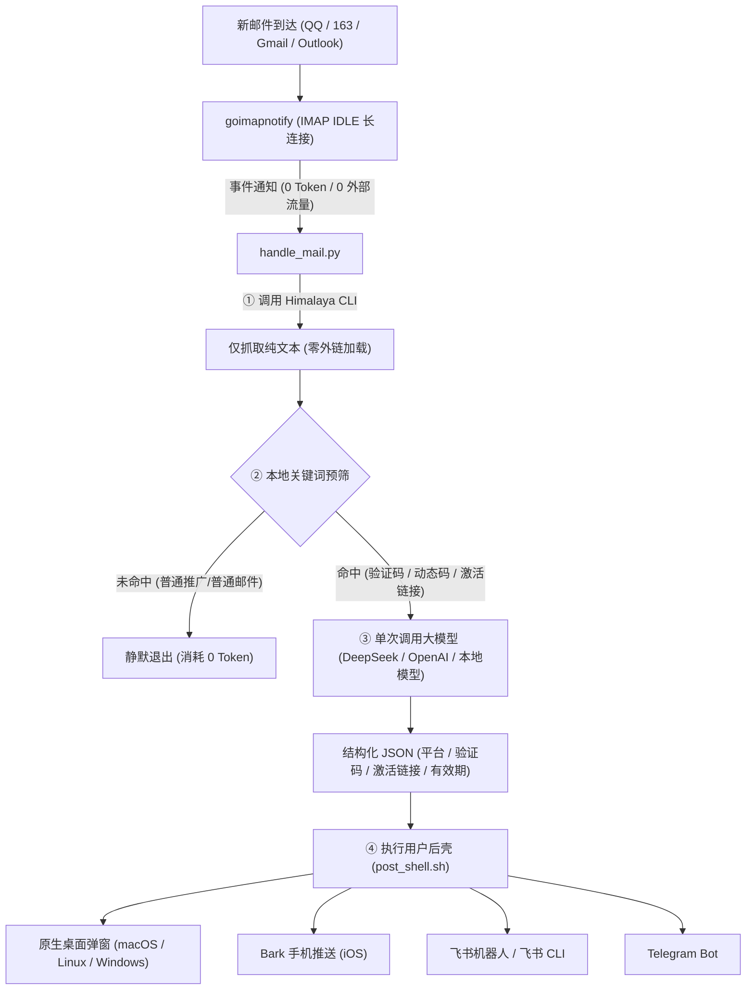

# 🛡️ mail-guard

> 安全隐私优先的多邮箱管理与事件驱动大模型自动化通知体系。  
> 核心特性：**零远程资源加载**、**纯文本严格隔离**、**IMAP IDLE 零 Token 监听**、**按需单次唤醒 LLM**、**可扩展用户后壳 (Post-Shell Hook)**。

---

## 💡 为什么需要 mail-guard？

普通邮件客户端或网页邮箱在打开邮件时，通常会加载远程图片、CSS 或执行脚本，发件人可通过「间谍像素 (Tracking Pixels)」轻易获取你的：
- **真实 IP 地址与地理位置**
- **精确开信时间与设备型号**

同时，传统让 AI 管理邮箱的方案往往依赖大模型轮询，产生**持续且高昂的 Token 账单**。

**mail-guard 的设计哲学：**
1. **物理级防追踪**：基于纯 IMAP 协议拉取，无任何浏览器渲染核心，绝对不发起针对邮件正文内任何外部资源的 HTTP/DNS 请求，发件人 100% 无法探测。
2. **纯文本严格隔离**：强制仅提取 `text/plain` 纯文本，HTML 标签在本地离线清洗，杜绝富媒体安全隐患。
3. **零 Token 闲置监控**：通过标准的 IMAP IDLE 协议长连接常驻后台，秒级响应新邮件，结合本地轻量规则粗筛，非目标邮件本地拦截，**闲置 Token 消耗严格为 0**。
4. **单次按需唤醒大模型**：仅当命中验证码、两步验证、安全告警等目标特征时，单次调用 LLM 提取结构化 JSON。
5. **自由用户后壳 (Post-Shell)**：提取完成后，无缝移交给用户配置的 Shell 脚本，自由联动 Bark、飞书机器人、Telegram、企业微信或桌面通知。
6. **多邮箱原生支持**：支持同时配置与监听多个邮箱账户（QQ 邮箱、Gmail、Outlook、163 等）。

---

## 🏗️ 架构流转



---

## 📂 项目结构

```
mail-guard/
├── .gitignore                   # 严格忽略个人凭据、私钥与环境变量
├── README.md                    # 项目说明文档
├── LICENSE                      # MIT 开源协议
├── install.sh                   # macOS & Linux 一键安装脚本
├── install.ps1                  # Windows PowerShell 一键安装脚本
├── setup_account.py             # 交互式邮箱账户配置与连通性验证工具
├── scripts/
│   ├── cli.py                   # 统一命令行工具 (mail-guard)
│   ├── query_mail.py            # Agent 多邮箱并发主动拉取 CLI
│   ├── handle_mail.py           # 核心流转：本地粗筛、LLM 结构化提取、调用后壳
│   ├── daily_summary.py         # 每日 4 次跨邮箱智能摘要与待办提炼
│   ├── post_shell.sh            # 用户后壳脚本：支持原生弹窗、Bark、飞书、TG
│   ├── ms_oauth2.py             # 微软 OAuth2 Device Code 授权与自动 Token 刷新
│   ├── run_daemon.py            # 跨平台多账号 IMAP IDLE 后台长连接守护管理器
│   ├── test_pipeline.py         # 跨平台纯 Python 端到端自测套件
│   └── test_pipeline.sh         # Shell 自测入口
├── config/
│   ├── mail-guard.env.example   # 大模型与推送通道配置模板
│   ├── accounts.json.example    # 多邮箱账户配置模板 (QQ/Gmail/Outlook)
│   ├── himalaya.config.toml.example # Himalaya 客户端配置模板
│   └── goimapnotify.yaml.example # goimapnotify 监听配置模板
├── launchd/
│   ├── com.weicoz.mailguard.plist.example # macOS 守护进程 launchd 配置模板
│   └── com.weicoz.mailguard.summary.plist.example # macOS 每日汇总定时模板
└── systemd/
    ├── mailguard.service.example         # Linux 守护进程 systemd 服务模板
    ├── mailguard-summary.service.example # Linux 每日汇总 systemd 服务模板
    └── mailguard-summary.timer.example   # Linux 4 次定时器 timer 模板
```

---

## 🚀 快速上手 (跨平台三端支持)

### 1. 环境安装

#### 🍎 macOS (Homebrew + LaunchAgents)
```bash
git clone https://github.com/Weicoz/mail-guard.git
cd mail-guard
chmod +x install.sh && ./install.sh
```

#### 🐧 Linux (systemd 用户服务)
```bash
git clone https://github.com/Weicoz/mail-guard.git
cd mail-guard
chmod +x install.sh && ./install.sh
```
> 该脚本会自动配置 `~/.config/systemd/user/mailguard.service` 守护服务与每日汇总定时器。

#### 🪟 Windows (PowerShell)
```powershell
git clone https://github.com/Weicoz/mail-guard.git
cd mail-guard
powershell -ExecutionPolicy Bypass -File .\install.ps1
```
> 该脚本会自动创建配置目录与 `mail-guard.cmd` 统一命令行入口。

### 2. 配置你的邮箱账户
运行交互式账户配置工具：
```bash
python3 setup_account.py  # Windows 下运行: python setup_account.py
```
根据提示输入你的**邮箱地址**和**应用授权码/密码**。脚本会自动识别邮箱服务商（QQ、163、Gmail、Outlook 等），配置服务器并即时测试连通性。

### 3. 配置推送通道与统一调度（推荐 harness-notify）
mail-guard 现已无缝接入本机统一推送组件 **[harness-notify](https://github.com/Weicoz/harness-notify)**：
- **统一多渠道调度**：自动按 `~/.config/harness-notify/config.json` 的 `routes` 规则将邮件重要待办与实时验证码分发至 **飞书 (`lark-cli`)**、**iOS Bark**、**Telegram** 或 **ntfy**。
- **免额外配置**：只需在 `config.json` 的 `routes` 中添加 `"mailguard": ["feishu", "phone"]` 即可实现全通道统一分发。
- **独立备用配置 (可选)**：若未安装 `harness-notify`，系统自动优雅降级为读取 `~/.config/mail-guard/mail-guard.env` 直连：
```bash
# 大模型 API (兼容 OpenAI / DeepSeek / 通义千问 / Ollama)
LLM_API_KEY="sk-..."
LLM_BASE_URL="https://api.deepseek.com/v1"
LLM_MODEL="deepseek-chat"

# 备用独立直发通道 (可选)
FEISHU_USER=""       # 飞书 open_id (配合本机 lark-cli 直推本人)
BARK_KEY=""          # iOS Bark 设备密钥
BARK_SERVER="https://api.day.app"
```
> 💡 若留空不配置 LLM API，系统会自动启用本地高精度正则提取器，完全免费且零成本。

### 4. 跨平台开箱通知与自定义后壳
- **原生桌面弹窗**：在 macOS (osascript)、Linux (notify-send) 与 Windows (PowerShell Toast) 均已开箱即用，无需第三方 Python 依赖。
- **统一通道测试**：运行 `mail-guard notify` 即可一键测试原生弹窗、`harness-notify` 调度与备用通道连通性。
- **端到端流水线自测**：运行 `mail-guard test` 自动运行从垃圾过滤、验证码提取到多通道推送的全链路自检。
- **自定义后壳 (post_shell.sh)**：优先调用 `harness-notify` 统一多渠道，失败自动降级为本地直接派发。

### 5. 启动后台实时监听与服务管理
统一 CLI 提供了跨平台的守护进程管理支持：
```bash
mail-guard daemon status   # 查看服务运行状态与监听进程
mail-guard daemon restart  # 重启后台监听
mail-guard daemon stop     # 停止后台监听
mail-guard daemon logs     # 实时查看监听日志
mail-guard notify          # 测试全通道消息推送连通性
mail-guard test            # 运行端到端流水线自测
```
- **macOS**：通过 `launchd`（`LaunchAgents`）托管。
- **Linux**：通过 `systemd --user` 用户级服务与定时器托管。
- **Windows**：通过系统后台任务或直接前台运行调试。

### 6. Agent 主动拉取邮件 (query_mail.py)
Agent 或命令行可随时主动查询最新邮件或结构化提炼验证码：
```bash
# 查询所有邮箱最新 1 封邮件
python3 scripts/query_mail.py

# 专供 Agent 解析的结构化 JSON 输出
python3 scripts/query_mail.py --account all --limit 2 --json

# 按关键词检索 (如寻找验证码、Proton 提醒)
python3 scripts/query_mail.py --account outlook --keyword "Proton"

# 按发件人检索并输出完整正文
python3 scripts/query_mail.py --from "tencent.com" --full
```
> 💡 默认采用 `BODY.PEEK[]` 只读模式拉取，绝对不会将服务器上的未读邮件标记为已读。

### 7. 每日跨邮箱智能汇总与待办提醒 (daily_summary.py)
全自动定时扫描 4 个邮箱，由大模型（DeepSeek）智能识别**待办事项 (Action Items)** 与 **重要告警 (Important Alerts)**，自动过滤营销噪音：
```bash
# 手动触发一次增量汇总 (支持 --dry-run 演练)
python3 scripts/daily_summary.py

# 自动定时运行：已注册至 macOS 原生 launchd，采用贴合生活与工作作息的 6 班制：
#   08:30 (早间晨报，打包整夜积压) | 12:00 (午间小结) | 15:30 (午后中场)
#   18:30 (下班盘点) | 21:30 (晚间收尾) | 00:30 (深夜最后一班)
#   00:30 至次日 08:30 整整 8 小时深度睡眠期间彻底静默，绝不打扰。
# 结果保存至 ~/.config/mail-guard/summaries/ 并通过 harness-notify 统一推送至飞书本人与 Bark
```

---

## 🔒 隐私与安全承诺

- **零凭据硬编码**：真实配置文件一律隔离在本地 `~/.config/`，并通过 `.gitignore` 严格排除，绝不上云。
- **只读最小权限**：仅通过 IMAP 协议读取文本，不支持亦不执行任何外部脚本。
- **本地管道化**：即使断开外网，邮件纯文本解析与本地正则提取依然 100% 可用。

---

## 📄 License
MIT License
