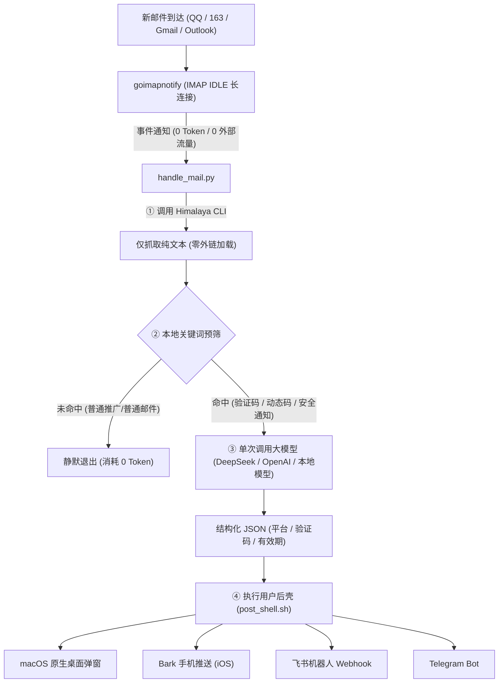

# 🛡️ mail-guard

> 安全隐私优先的多邮箱管理与事件驱动大模型自动化通知体系。  
> 核心特性：**零远程资源加载**、**纯文本严格隔离**、**IMAP IDLE 零 Token 监听**、**按需单次唤醒 LLM**、**可扩展用户后壳 (Post-Shell Hook)**。

---

## 💡 为什么需要 mail-guard？

普通邮件客户端或网页邮箱在打开邮件时，通常会加载远程图片、CSS 或执行脚本，发件人可通过「间谍像素 (Tracking Pixels)」轻易获取你的：
- **真实 IP 地址与地理位置**
- **精确开信时间与设备型号**

同时，传统让 AI 管理邮箱的方案往往依赖大模型轮询，产生**持续且高昂的 Token 账单**。

**mail-guard 的设计哲学：**
1. **物理级防追踪**：基于纯 IMAP 协议拉取，无任何浏览器渲染核心，绝对不发起针对邮件正文内任何外部资源的 HTTP/DNS 请求，发件人 100% 无法探测。
2. **纯文本严格隔离**：强制仅提取 `text/plain` 纯文本，HTML 标签在本地离线清洗，杜绝富媒体安全隐患。
3. **零 Token 闲置监控**：通过标准的 IMAP IDLE 协议长连接常驻后台，秒级响应新邮件，结合本地轻量规则粗筛，非目标邮件本地拦截，**闲置 Token 消耗严格为 0**。
4. **单次按需唤醒大模型**：仅当命中验证码、两步验证、安全告警等目标特征时，单次调用 LLM 提取结构化 JSON。
5. **自由用户后壳 (Post-Shell)**：提取完成后，无缝移交给用户配置的 Shell 脚本，自由联动 Bark、飞书机器人、Telegram、企业微信或桌面通知。
6. **多邮箱原生支持**：支持同时配置与监听多个邮箱账户（QQ 邮箱、Gmail、Outlook、163 等）。

---

## 🏗️ 架构流转



---

## 📂 项目结构

```
mail-guard/
├── .gitignore                   # 严格忽略个人凭据、私钥与环境变量
├── README.md                    # 项目说明文档
├── install.sh                   # 一键安装与环境部署脚本
├── setup_account.py             # 交互式邮箱账户配置与连通性验证工具
├── scripts/
│   ├── handle_mail.py           # 核心流转：本地粗筛、LLM 结构化提取、调用后壳
│   ├── post_shell.sh            # 用户后壳脚本：支持桌面通知、Bark、飞书、TG
│   └── test_pipeline.sh         # 端到端自测模拟流水线
├── config/
│   ├── mail-guard.env.example   # 大模型 API 配置模板
│   ├── himalaya.config.toml.example # Himalaya 多邮箱配置模板
│   └── goimapnotify.yaml.example    # goimapnotify 监听配置模板
└── launchd/
    └── com.weicoz.mailguard.plist   # macOS 原生 launchd 开机守护配置模板
```

---

## 🚀 快速上手

### 1. 环境安装
直接运行项目根目录下的部署脚本：
```bash
./install.sh
```
该脚本会自动：
- 检查并通过 Homebrew 安装 `himalaya` 与 `goimapnotify`。
- 将核心配置与脚本部署至 `~/.config/mail-guard/`。
- 自动运行端到端模拟测试。

### 2. 配置你的邮箱账户
运行交互式账户配置工具：
```bash
python3 setup_account.py
```
根据提示输入你的**邮箱地址**和**应用授权码/密码**。脚本会自动识别邮箱服务商（QQ、163、Gmail、Outlook 等），配置服务器并即时测试连通性。

### 3. 配置大模型 API（可选）
编辑 `~/.config/mail-guard/mail-guard.env`：
```bash
LLM_API_KEY="sk-..."
LLM_BASE_URL="https://api.deepseek.com/v1"   # 兼容 OpenAI / DeepSeek / 通义千问 / Ollama
LLM_MODEL="deepseek-chat"
```
> 💡 若留空不配置 API，系统会自动启用本地高精度正则提取器，完全免费且零成本。

### 4. 自定义你的推送后壳
编辑 `~/.config/mail-guard/post_shell.sh`：
- 默认已启用 macOS 原生桌面弹窗通知。
- 按需取消注释 `Bark`、`飞书 Webhook` 或 `Telegram` 配置块，填入你的 Key 即可。

### 5. 启动后台实时监听
在终端直接前台运行调试：
```bash
goimapnotify -conf ~/.config/goimapnotify/goimapnotify.yaml
```
或配置为系统开机自启服务：
```bash
brew services start goimapnotify
```

---

## 🔒 隐私与安全承诺

- **零凭据硬编码**：真实配置文件一律隔离在本地 `~/.config/`，并通过 `.gitignore` 严格排除，绝不上云。
- **只读最小权限**：仅通过 IMAP 协议读取文本，不支持亦不执行任何外部脚本。
- **本地管道化**：即使断开外网，邮件纯文本解析与本地正则提取依然 100% 可用。

---

## 📄 License
MIT License
